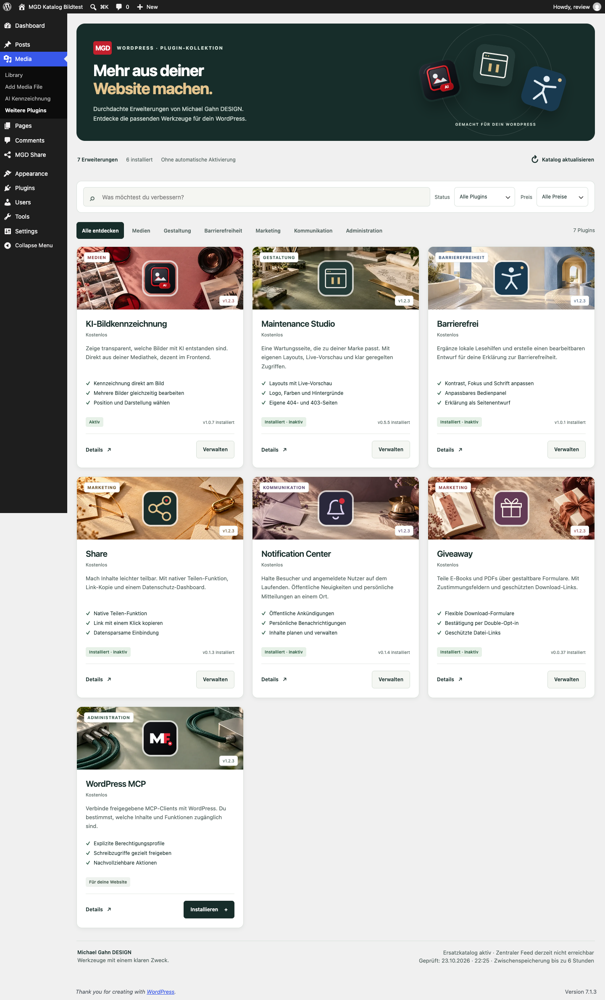

<div align="center">


# MGD Share

**Eine konfigurierbare Teilen-Funktion für WordPress – ohne vorab geladene Social-Media-Skripte.**

[](https://wordpress.org/)
[](https://www.php.net/)
[](mgd-share-wordpress/LICENSE)

[Repository](https://github.com/MichaelGahnDESIGN/MGD-Share-WordPress) · [Issues](https://github.com/MichaelGahnDESIGN/MGD-Share-WordPress/issues) · [Sicherheitsrichtlinie](SECURITY.md)

</div>

---

MGD Share bringt einen Share-Button mit **Link kopieren**, System-Teilen, E-Mail und optionalen Plattform-Links in WordPress. Anders als eingebettete Social-Share-Widgets lädt das Plugin beim Seitenaufruf keine Ressourcen von WhatsApp, LinkedIn oder anderen Plattformen. Erst nach einem Klick öffnet sich das gewählte Ziel.

> **Status:** Erste Testversion. Die Datenschutz-Hinweise sind technische Orientierung für DE und EU und ersetzen keine Rechtsberatung.

## Funktionen

| Bereich | Enthalten |
| --- | --- |
| Link teilen | Kopieren in die Zwischenablage mit zugänglicher Rückmeldung |
| System-Funktion | Web Share API auf unterstützten Geräten |
| Externe Ziele | E-Mail, WhatsApp und LinkedIn – erst nach Klick |
| Darstellung | Vor/Nach Inhalt oder frei über Shortcode, drei Stile und Akzentfarbe |
| Dashboard | Datenschutz-Check und Erkennung bekannter Datenschutz-Plugins |
| Datenschutz | Keine Social-Media-Skripte, Cookies oder Tracking-Aufrufe durch MGD Share |

## Installation

1. Lade [**MGD Share 0.1.5**](https://github.com/MichaelGahnDESIGN/MGD-Share-WordPress/releases/download/v0.1.5/mgd-share-wordpress-0.1.5.zip) herunter oder erzeuge lokal ein Paket.
2. Öffne in WordPress **Plugins → Installieren → Plugin hochladen**.
3. Aktiviere **MGD Share**.
4. Konfiguriere unter **MGD Share → Einstellungen** Position, Funktionen und Design.

Die automatische Position kann vor oder nach dem Inhalt erfolgen. Für Block-Editor, Page Builder und Theme-Templates steht der Shortcode bereit:

```text
[mgd_share]
```

## Datenschutz-Dashboard

Unter **MGD Share → Dashboard** findest du:

- eine konkrete technische Checkliste für Datenschutzerklärung und Tracking-Parameter,
- erkannte Datenschutz-Plugins wie Complianz, Real Cookie Banner und Borlabs Cookie,
- den Hinweis, dass für die lokale Share-Leiste selbst kein Consent erforderlich ist, weil sie keine externen Ressourcen vor dem Klick lädt.

Das Plugin verändert keine Optionen anderer Datenschutz-Plugins automatisch. Solche Optionen sind installations- und rechtskontextabhängig; blindes Umschreiben könnte eine bestehende Einwilligungs-Konfiguration beschädigen. Sobald ein Anbieter eine stabile, dokumentierte API für eine passende Einstellung bereitstellt, kann ein gezielter Adapter ergänzt werden.

## Technische Datenschutzregeln

1. Auf Seiten mit MGD Share werden keine Social-Media-Skripte, Pixel oder Iframes eingebunden.
2. Der Link in die Zwischenablage bleibt im Browser und wird nicht an den Server gesendet.
3. Externe Plattformen werden nur nach einer aktiven Auswahl geöffnet.
4. Tracking- oder personenbezogene URL-Parameter gehören nicht in Share-Links ohne eigene rechtliche Prüfung.

Prüfe vor dem Livegang Datenschutzerklärung, eingesetzte Tracking-Tools und den tatsächlichen Seitenaufruf. Bei rechtlichen Zweifeln ist fachliche Beratung nötig.

## Entwicklung und Paketprüfung

```bash
find mgd-share-wordpress -name '*.php' -exec php -l {} \;
node --check mgd-share-wordpress/assets/share.js
python3 scripts/check-docs.py
python3 scripts/build-package.py
```

Das installierbare Paket wird unter `dist/mgd-share-wordpress-0.1.5.zip` erzeugt.

## Sicherheit

Bitte keine Sicherheitslücken, Zugangsdaten oder personenbezogenen Testdaten in öffentlichen Issues posten. Hinweise stehen in [SECURITY.md](SECURITY.md).

## Lizenz

[GPL-2.0-or-later](mgd-share-wordpress/LICENSE)

## 0.1.1 – Plugin-Verwaltung

Separate Update-Prüfung, Plugin-Links und ergänzte lokale Details. [Anleitung](docs/WORDPRESS-VERWALTUNG.md).

## 0.1.2 – Neue Plugin-Kollektion

Die bisherige Empfehlungstabelle wird zur Plugin-Kollektion mit eigenen Icons, vollständigen Beschreibungen, Suche, Kategorie-, Status- und Preisfiltern. Details öffnen sich im Dialog; Installationen bleiben ausdrücklich bestätigt und aktivieren kein Plugin automatisch. Die Übersicht funktioniert auch mit noch älteren MGD-Katalog-Verbrauchern.



[Gestaltung, Datenquelle, Sicherheit und Prüfung](docs/PLUGIN-KATALOG.md). Der externe Katalog gehört zur GitHub-Ausgabe; die getrennten WordPress.org-Kandidaten bleiben unverändert.

## 0.1.3 – Updateanzeige nach der Installation

Die Übersicht vergleicht zwischengespeicherte WordPress-Updateangebote zusätzlich mit der tatsächlich installierten Version. Gleiche, ältere oder fehlende Versionsangaben zeigen keine erneute Updateaktion. Sieben Regressionstests sichern diesen Zustand und die Rechteprüfung ab.

## 0.1.4 – Eigene Motive in der Plugin-Kollektion

Sieben passende, lokal mitgelieferte Hintergrundbilder ergänzen die Plugin-Karten. Icons, Suche und Filter bleiben erhalten. [Gestaltung und Herkunft](docs/PLUGIN-KATALOG.md#kartenmotive--24102026).

## 0.1.5 – Wartungsrelease

Die GitHub-Prüfungen verwenden aktualisierte, gepinnte Abhängigkeiten. Das verbessert die Wartbarkeit der Release-Prüfung; die Share-Funktionen und die Datenflüsse für Besucherinnen und Besucher bleiben unverändert.
