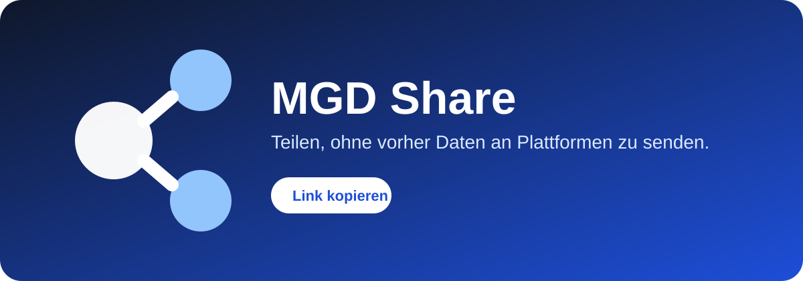
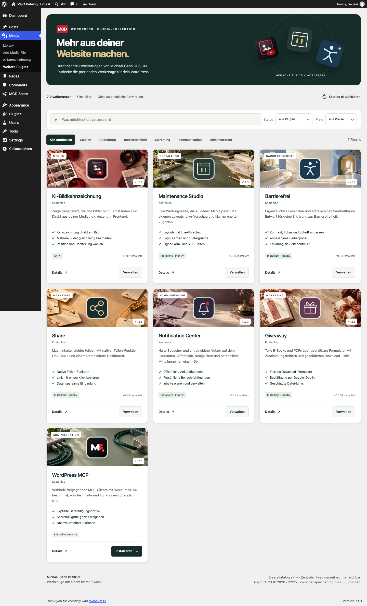

<div align="center">



# MGD Share

**Eine konfigurierbare Teilen-Funktion für WordPress – ohne vorab geladene Social-Media-Skripte.**

[](https://wordpress.org/)
[](https://www.php.net/)
[](mgd-share-wordpress/LICENSE)

[Repository](https://github.com/MichaelGahnDESIGN/MGD-Share-WordPress) · [Issues](https://github.com/MichaelGahnDESIGN/MGD-Share-WordPress/issues) · [Sicherheitsrichtlinie](SECURITY.md)

</div>

---

MGD Share bringt einen Share-Button mit **Link kopieren**, System-Teilen, E-Mail und optionalen Plattform-Links in WordPress. Anders als eingebettete Social-Share-Widgets lädt das Plugin beim Seitenaufruf keine Ressourcen von WhatsApp, LinkedIn oder anderen Plattformen. Erst nach einem Klick öffnet sich das gewählte Ziel.

> **Status:** Erste Testversion. Die Datenschutz-Hinweise sind technische Orientierung für DE und EU und ersetzen keine Rechtsberatung.

## Funktionen

| Bereich | Enthalten |
| --- | --- |
| Link teilen | Kopieren in die Zwischenablage mit zugänglicher Rückmeldung |
| System-Funktion | Web Share API auf unterstützten Geräten |
| Externe Ziele | E-Mail, WhatsApp, LinkedIn, Facebook, Telegram, Pinterest, Reddit, XING, Bluesky, Threads und Drucken – erst nach Klick |
| Darstellung | 4 Formen, 4 Stile, 3 Größen, Icon und/oder Text, Markenfarben oder eigene Akzentfarbe, Effekte beim Drüberfahren |
| Position | Vor/nach dem Inhalt, schwebend am Rand, als Leiste unten am Handy oder frei über Shortcode |
| Einstellungen | Live-Vorschau, 6 Vorlagen zum Schnellstart, Reihenfolge per Ziehen |
| Dashboard | Datenschutz-Check und Erkennung bekannter Datenschutz-Plugins |
| Datenschutz | Keine Social-Media-Skripte, Cookies oder Tracking-Aufrufe durch MGD Share |

## Installation

1. Lade [**MGD Share 0.3.0**](https://github.com/MichaelGahnDESIGN/MGD-Share-WordPress/releases/download/v0.3.0/mgd-share-wordpress-0.3.0.zip) herunter oder erzeuge lokal ein Paket.
2. Öffne in WordPress **Plugins → Installieren → Plugin hochladen**.
3. Aktiviere **MGD Share**.
4. Konfiguriere unter **MGD Share → Einstellungen** Position, Funktionen und Design.

Die automatische Position kann vor oder nach dem Inhalt erfolgen. Für Block-Editor, Page Builder und Theme-Templates steht der Shortcode bereit:

```text
[mgd_share]
```

Du kannst im Shortcode einzelne Einstellungen ändern. Beispiel: bunte Pillen nur mit WhatsApp, E-Mail und Link kopieren:

```text
[mgd_share shape="pill" variant="solid" color_mode="brand" networks="whatsapp,email,copy"]
```

Mögliche Angaben: `shape` (rounded, square, pill, circle), `variant` (solid, outline, soft, ghost), `color_mode` (accent, brand, mono), `size` (s, m, l), `display` (icon-text, icon, text), `align` (left, center, right, spread), `hover` (lift, grow, glow, none), `container` (card, plain), `accent` (Farbe wie #c8161a), `label`, `show_label` (true/false) und `networks` (Liste mit Komma).

## Datenschutz-Dashboard

Unter **MGD Share → Dashboard** findest du:

- eine konkrete technische Checkliste für Datenschutzerklärung und Tracking-Parameter,
- erkannte Datenschutz-Plugins wie Complianz, Real Cookie Banner und Borlabs Cookie,
- den Hinweis, dass für die lokale Share-Leiste selbst kein Consent erforderlich ist, weil sie keine externen Ressourcen vor dem Klick lädt.

Das Plugin verändert keine Optionen anderer Datenschutz-Plugins automatisch. Solche Optionen sind installations- und rechtskontextabhängig; blindes Umschreiben könnte eine bestehende Einwilligungs-Konfiguration beschädigen. Sobald ein Anbieter eine stabile, dokumentierte API für eine passende Einstellung bereitstellt, kann ein gezielter Adapter ergänzt werden.

## Technische Datenschutzregeln

1. Auf Seiten mit MGD Share werden keine Social-Media-Skripte, Pixel oder Iframes eingebunden.
2. Der Link in die Zwischenablage bleibt im Browser und wird nicht an den Server gesendet.
3. Externe Plattformen werden nur nach einer aktiven Auswahl geöffnet.
4. Tracking- oder personenbezogene URL-Parameter gehören nicht in Share-Links ohne eigene rechtliche Prüfung.

Prüfe vor dem Livegang Datenschutzerklärung, eingesetzte Tracking-Tools und den tatsächlichen Seitenaufruf. Bei rechtlichen Zweifeln ist fachliche Beratung nötig.

## Entwicklung und Paketprüfung

```bash
find mgd-share-wordpress -name '*.php' -exec php -l {} \;
node --check mgd-share-wordpress/assets/share.js
python3 scripts/check-docs.py
python3 scripts/build-package.py
```

Das installierbare Paket wird unter `dist/mgd-share-wordpress-0.3.0.zip` erzeugt.

## Sicherheit

Bitte keine Sicherheitslücken, Zugangsdaten oder personenbezogenen Testdaten in öffentlichen Issues posten. Hinweise stehen in [SECURITY.md](SECURITY.md).

## Lizenz

[GPL-2.0-or-later](mgd-share-wordpress/LICENSE)

## 0.1.1 – Plugin-Verwaltung

Separate Update-Prüfung, Plugin-Links und ergänzte lokale Details. [Anleitung](docs/WORDPRESS-VERWALTUNG.md).

## 0.1.2 – Neue Plugin-Kollektion

Die bisherige Empfehlungstabelle wird zur Plugin-Kollektion mit eigenen Icons, vollständigen Beschreibungen, Suche, Kategorie-, Status- und Preisfiltern. Details öffnen sich im Dialog; Installationen bleiben ausdrücklich bestätigt und aktivieren kein Plugin automatisch. Die Übersicht funktioniert auch mit noch älteren MGD-Katalog-Verbrauchern.



[Gestaltung, Datenquelle, Sicherheit und Prüfung](docs/PLUGIN-KATALOG.md). Der externe Katalog gehört zur GitHub-Ausgabe; die getrennten WordPress.org-Kandidaten bleiben unverändert.

## 0.1.3 – Updateanzeige nach der Installation

Die Übersicht vergleicht zwischengespeicherte WordPress-Updateangebote zusätzlich mit der tatsächlich installierten Version. Gleiche, ältere oder fehlende Versionsangaben zeigen keine erneute Updateaktion. Sieben Regressionstests sichern diesen Zustand und die Rechteprüfung ab.

## 0.1.4 – Eigene Motive in der Plugin-Kollektion

Sieben passende, lokal mitgelieferte Hintergrundbilder ergänzen die Plugin-Karten. Icons, Suche und Filter bleiben erhalten. [Gestaltung und Herkunft](docs/PLUGIN-KATALOG.md#kartenmotive--24102026).

## 0.1.5 – Wartungsrelease

Die GitHub-Prüfungen verwenden aktualisierte, gepinnte Abhängigkeiten. Das verbessert die Wartbarkeit der Release-Prüfung; die Share-Funktionen und die Datenflüsse für Besucherinnen und Besucher bleiben unverändert.

## 0.1.6 – Icons und Hintergründe aus dem Feed (27.10.2026)

Icons und Hintergründe der Karten unter „Weitere Plugins" kommen jetzt aus theme.michael-gahn.de. Der Server holt sie einmal und speichert sie lokal; der Browser lädt nichts extern. Ohne Bild bleibt das mitgelieferte Motiv. Versionen werden ohne führendes „v" angezeigt.

## 0.2.0 – Neuer Update-Weg und neue Liste „Weitere Plugins“ (21.11.2026)

Diese Version ist eine Brückenversion. Deine Einstellungen bleiben genau so, wie sie sind.

- **Updates:** WordPress zeigt neue Versionen jetzt über theme.michael-gahn.de an. Vor der Installation wird geprüft, ob die Datei vollständig und unverändert ist (Größe und Prüfsumme). Der alte Update-Weg über GitHub ist abgeschaltet.
- **Automatische Updates** bleiben aus, bis du sie selbst unter „Plugins“ einschaltest.
- **Neue Seite „Info und Updates“:** Unter „MGD Share“ findest du jetzt eine Seite mit Version, Update-Stand, weiteren Plugins und dem Schalter „Installation melden“. Die weiteren Plugins erscheinen als einfache Karten mit Name, Beschreibung, Version und dem Link „Mehr erfahren“. Antwortet der Server nicht, siehst du eine mitgelieferte Liste.
- **X/Twitter als Ziel entfernt.** X kann nicht mehr ausgewählt werden. War X in deinen Einstellungen aktiv, wird es beim Update entfernt. Alle anderen Ziele und das System-Teilen des Browsers bleiben, wie sie sind.
- **Installation melden:** Auf der Seite „Info und Updates“ gibt es einen Schalter. Ist er an, meldet sich das Plugin höchstens einmal am Tag bei theme.michael-gahn.de (Plugin-Name, Version, Shopsystem, Domain, zufällige Installations-ID). Du kannst ihn jederzeit abschalten.

## 0.3.0 – Mehr Design und mehr Netzwerke (21.11.2026)

Deine bisherigen Einstellungen bleiben erhalten. Die Leiste sieht nach dem Update genauso aus wie vorher, bis du etwas änderst.

- **Neue Einstellungsseite mit Live-Vorschau:** Jede Änderung siehst du sofort, auf hellem oder dunklem Hintergrund.
- **Schnellstart-Vorlagen:** Klassisch, Bunte Pillen, Icon-Kreise, Sanft, Minimal und Kräftig eckig.
- **Aussehen:** 4 Formen (abgerundet, eckig, Pille, Kreis), 4 Stile (gefüllt, Rahmen, sanft getönt, nur Icon/Text), 3 Größen, Icon und/oder Text, Effekte beim Drüberfahren, mit oder ohne Box, Ausrichtung.
- **Farben:** eine Akzentfarbe, die Markenfarben der Netzwerke oder schlicht grau. Die Schrift auf gefüllten Buttons wird automatisch gut lesbar gewählt.
- **Neue Ziele:** Facebook, Telegram, Pinterest, Reddit, XING, Bluesky, Threads und Drucken. Alle mit Logo, alle lokal im Plugin. Vor dem Klick wird nichts von außen geladen.
- **Reihenfolge:** Buttons per Ziehen oder mit den Pfeilen sortieren.
- **Neue Positionen:** vor und nach dem Inhalt gleichzeitig, schwebend am linken oder rechten Rand und als Leiste unten am Handy.
- **Link kopieren:** Der Button zeigt kurz „Kopiert!“ mit Häkchen.
- **Shortcode mit eigenen Werten**, zum Beispiel `[mgd_share shape="pill" networks="whatsapp,copy"]`.

